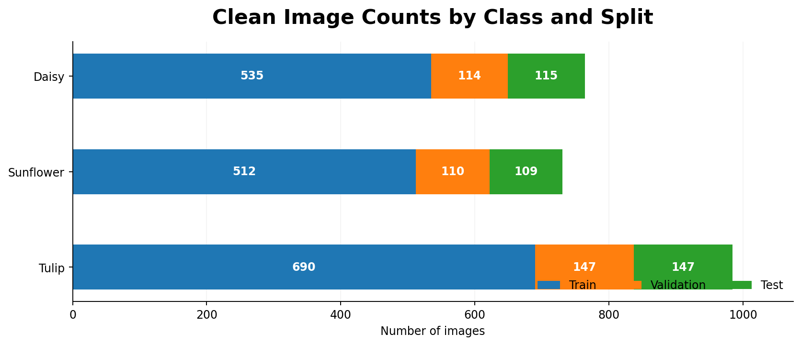
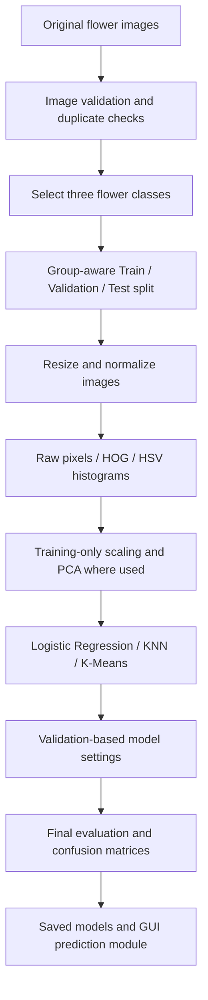
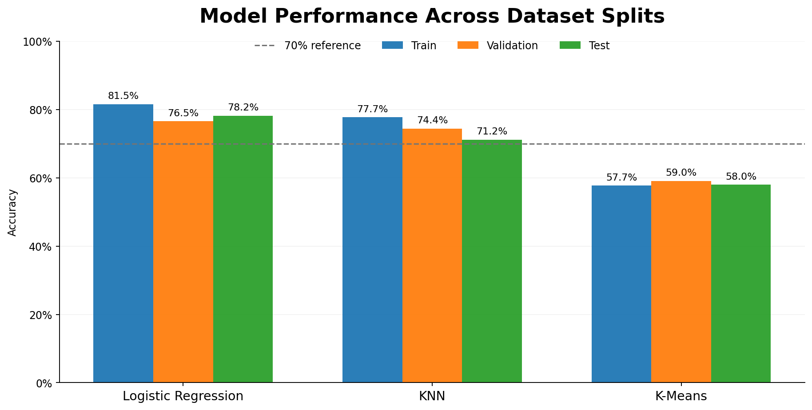
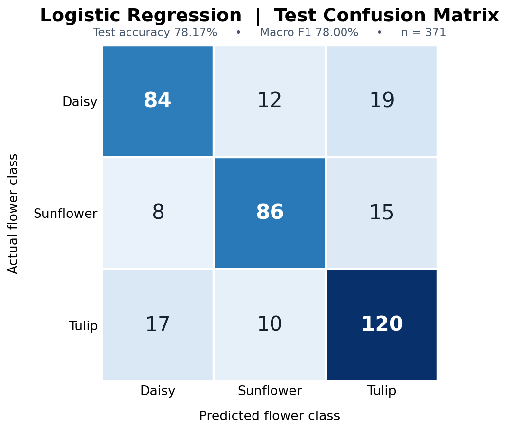
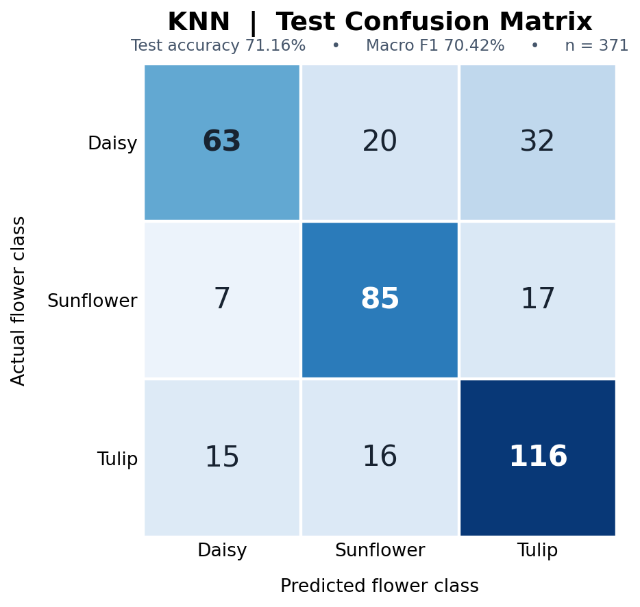
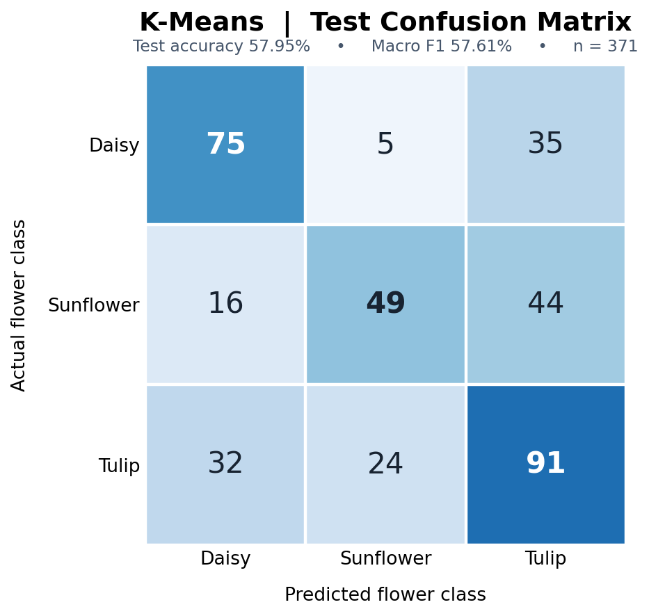

<div align="center">

# Flower Recognition
### Classical Machine Learning · Part B · Image Classification

**Daisy · Sunflower · Tulip**


A coursework project that compares **Logistic Regression**, **K-Nearest Neighbors**, and **K-Means** using traditional image features. The project includes a reproducible training notebook, evaluation results, three saved models, and a prediction module ready to connect to a graphical interface.

**Best test accuracy: 78.17% — Logistic Regression**

[Overview](#project-overview) · [Methodology](#machine-learning-workflow) · [Results](#model-results) · [Confusion Matrices](#confusion-matrices) · [Setup](#installation-and-quick-start) · [GUI Integration](#gui-integration)

</div>

---

## Project overview

The objective is to identify the flower type in a photo using **three classes** selected from the original five-class Flowers Recognition dataset:

| Class | What the model predicts |
|:--|:--|
| **Daisy** | `daisy` |
| **Sunflower** | `sunflower` |
| **Tulip** | `tulip` |

The original collection contains five flower categories. This project deliberately uses **three** of them to meet the coursework requirement of classifying **3–5 classes**. Results are specific to this three-class problem and are not directly comparable to five-class accuracy.

### Project summary

| Item | Details |
|:--|:--|
| Task | Image classification; clustering for comparison |
| Learning methods | Logistic Regression and KNN (supervised); K-Means (unsupervised) |
| Clean image count | **2,479** |
| Dataset split | **1,737 Train / 371 Validation / 371 Test** |
| Image representation | Raw pixels, HOG features, HSV color histograms |
| Dimensionality reduction | PCA, where appropriate |
| Main metric | Accuracy; Macro F1 and Confusion Matrix also reported |
| Best classifier | **Logistic Regression** |
| User-facing inference | `predict_flower.py` and saved `.joblib` models |

### Dataset distribution



The split is approximately **70% Training, 15% Validation, and 15% Test**. Its exact size reflects the group-aware splitting procedure.

| Flower | Train | Validation | Test | Total |
|:--|--:|--:|--:|--:|
| Daisy | 535 | 114 | 115 | **764** |
| Sunflower | 512 | 110 | 109 | **731** |
| Tulip | 690 | 147 | 147 | **984** |
| **Total** | **1,737** | **371** | **371** | **2,479** |

> **Dataset availability:** The original flower photos are **not included in this GitHub repository**. A local copy is needed to rerun training, but it is **not** needed for inference with the saved models. Dataset source: [Flowers Recognition on Kaggle](https://www.kaggle.com/datasets/alxmamaev/flowers-recognition). Check the dataset's licensing conditions before redistributing images.

---

## Machine learning workflow



### 1. Data validation and cleaning

The notebook checks images for readability and valid dimensions, removes exact duplicates, and excludes images with conflicting labels. It uses **SHA-256** to detect identical image content and a **DCT-based fingerprint** to identify visually similar images for grouping.

Images belonging to the same fingerprint group are assigned to the same split to reduce the chance of closely related images appearing in both training and evaluation data. The process uses `random_state=42`.

### 2. Preprocessing and feature extraction

Images are resized to **128 × 128 pixels** for HOG and color features. Pixel values are normalized to the **0–1** range. The three feature representations are:

| Feature | Description | Role |
|:--|:--|:--|
| **Raw pixels** | A 24 × 24 RGB image flattened into a vector | Input to the K-Means feature pipeline |
| **HOG** | Histogram of Oriented Gradients, based on edge directions | Shape and edge information for Logistic Regression |
| **HSV color histograms** | Color distributions calculated for the whole image and selected image regions | Color information for Logistic Regression and KNN |

HOG uses **9 orientations**, a **16 × 16 pixel cell**, and **2 × 2 cells per block**. HSV information is obtained from the whole image, its center, and four quadrants. The resulting features capture both appearance and color, without neural networks or pretrained models.

### 3. Scaling and dimensionality reduction

`StandardScaler` and `PCA` are fitted **only on Training data**, then reused for Validation, Test, and new images. The notebook uses **40 PCA components** for each feature block in the reduced representations.

Different models use different feature inputs:

| Model | Input features | Saved preprocessing |
|:--|:--|:--|
| Logistic Regression | Reduced HOG + reduced HSV histograms | HOG and color scalers + PCAs |
| KNN | Original HSV histogram features | Feature ordering and label encoder |
| K-Means | Reduced raw RGB pixels | Raw scaler + PCA + cluster-to-class mapping |

### 4. Training and model selection

**Logistic Regression** evaluates regularization values `C = 0.003, 0.01, 0.03, 0.1`. The final saved configuration uses **C = 0.01**, with `max_iter=500`.

**KNN** compares `k = 9, 15, 25, 41` using **Manhattan** and **Euclidean** distances. The final model uses **25 neighbors**, **Manhattan distance**, and uniform voting.

**K-Means** compares **3, 6, 12, and 24 clusters** with `n_init=10` and `random_state=42`. The saved version uses **24 clusters**, selected according to **Validation accuracy**, not Silhouette Score. K-Means learns clusters without class labels; a **majority-label mapping calculated on Training data** assigns each cluster to a flower type for accuracy evaluation and predictions.

### 5. Evaluation protocol

The model settings are chosen using the Training and Validation partitions. Final evaluation reports **Accuracy**, **Macro F1**, **per-class Precision / Recall / F1**, and **Confusion Matrices**. Silhouette Score is reported for K-Means separately.

The Test partition was also examined during earlier coursework versions. Therefore, the reported scores are a **project benchmark**, not a completely untouched external test.

---

## Model results

### Accuracy comparison



| Model | Train accuracy | Validation accuracy | Test accuracy | Test Macro F1 |
|:--|--:|--:|--:|--:|
| **Logistic Regression** | **81.52%** | **76.55%** | **78.17%** | **78.00%** |
| KNN | 77.72% | 74.39% | 71.16% | 70.42% |
| K-Means | 57.69% | 59.03% | 57.95% | 57.61% |

**Logistic Regression** is the best supervised classifier on this dataset. It achieved the highest Validation accuracy and Test accuracy, with a Train–Validation gap of approximately **4.97 percentage points**. KNN also exceeded 70% accuracy across the three splits.

The lower K-Means result reflects weaker alignment between its **unsupervised clusters** and the known flower categories. The selected 24-cluster model has a **Training Silhouette Score of 0.0584**, indicating limited separation in the chosen raw-pixel PCA feature space. It is not accurate to treat its cluster quality as directly equivalent to supervised-classifier underfitting.

---

## Confusion matrices

A Confusion Matrix compares **actual labels (rows)** with **predicted labels (columns)**. Counts along the diagonal are correct predictions, while off-diagonal counts show misclassifications. Each matrix below represents the **same 371-image Test set**.

### Logistic Regression — best overall classifier



Logistic Regression correctly classified **84 Daisy**, **86 Sunflower**, and **120 Tulip** images. It performed best overall on the selected three classes.

### KNN



KNN correctly identified **63 Daisy**, **85 Sunflower**, and **116 Tulip** images. Daisy recall was weaker than for the other two classes.

### K-Means



K-Means correctly mapped **75 Daisy**, **49 Sunflower**, and **91 Tulip** images after applying Training-set majority voting. Sunflower and Tulip were frequently mixed across clusters.

<details>
<summary><strong>Per-class Test precision, recall, and F1 score</strong></summary>

The values below are percentages, rounded to two decimal places.

| Model | Flower | Precision | Recall | F1 |
|:--|:--|--:|--:|--:|
| Logistic Regression | Daisy | 77.06 | 73.04 | 75.00 |
| Logistic Regression | Sunflower | 79.63 | 78.90 | 79.26 |
| Logistic Regression | Tulip | 77.92 | 81.63 | 79.73 |
| KNN | Daisy | 74.12 | 54.78 | 63.00 |
| KNN | Sunflower | 70.25 | 77.98 | 73.91 |
| KNN | Tulip | 70.30 | 78.91 | 74.36 |
| K-Means | Daisy | 60.98 | 65.22 | 63.03 |
| K-Means | Sunflower | 62.82 | 44.95 | 52.41 |
| K-Means | Tulip | 53.53 | 61.90 | 57.41 |

</details>

---

## Project structure

```text
machine-learning-project/
├── .gitignore
└── part_b_image/
    ├── README.md
    ├── flowers_recognition.ipynb
    ├── predict_flower.py
    ├── requirements.txt
    ├── figures/
    │   ├── accuracy_comparison.png
    │   ├── dataset_distribution.png
    │   ├── confusion_matrix_logistic_regression.png
    │   ├── confusion_matrix_knn.png
    │   └── confusion_matrix_k_means.png
    └── models/
        ├── logistic_regression.joblib
        ├── knn.joblib
        └── kmeans.joblib
```

The `.ipynb` file contains the full training, evaluation, visualizations, and model-export workflow. The `.joblib` files contain the fitted models and the information required for inference. `predict_flower.py` provides a small, reusable interface between those models and a future GUI.

---

## Installation and quick start

### Requirements

- **Windows / Python 3.12** is the environment used for the handoff.
- `numpy`, `scikit-learn`, `scikit-image`, `scipy`, `Pillow`, and `joblib` are listed in `requirements.txt` with the saved-model compatibility versions.
- The original Dataset is **not required** to run predictions.

### Clone and install

Open **PowerShell** in the intended folder:

```powershell
git clone https://github.com/malakmohamed172/machine-learning-project.git
cd machine-learning-project\part_b_image
py -3.12 -m venv .venv
.\.venv\Scripts\python.exe -m pip install -r requirements.txt
```

Using a virtual environment avoids conflicts with packages installed for other projects.

### Predict a flower image

```powershell
.\.venv\Scripts\python.exe predict_flower.py "C:\path\to\flower.jpg"
```

The command prints the prediction from **all three models**, for example:

```text
logistic_regression: sunflower
knn: sunflower
kmeans: daisy
```

*The example demonstrates the output format; predictions will depend on the supplied image.*

---

## GUI integration

The repository includes the **machine-learning backend**, not a completed graphical application. The interface developer can use `predict_flower.py` without rerunning the notebook or loading training images.

### Prediction flow


### Python interface

```python
from predict_flower import load_models, predict_flower, predict_all

# Load once when the application starts
models = load_models()

# Predict with the selected model
flower = predict_flower("flower.jpg", "logistic_regression", models)
print(flower)

# Or compare all three models
results = predict_all("flower.jpg", models)
print(results)
```

Available model keys:

| UI model choice | Python key | Model file |
|:--|:--|:--|
| Logistic Regression | `logistic_regression` | `models/logistic_regression.joblib` |
| KNN | `knn` | `models/knn.joblib` |
| K-Means | `kmeans` | `models/kmeans.joblib` |

The prediction functions accept an **image file path**, a **PIL Image**, or a compatible uploaded file. For **Streamlit**, the uploaded image object can be passed directly to `predict_flower()`. For **Tkinter**, the file-picker path can be supplied. Both one-model and all-model comparisons are supported.

<details>
<summary><strong>Minimal Streamlit integration example</strong></summary>

Streamlit is **not included** in the current `requirements.txt`; install it separately if that is the chosen GUI framework.

```python
import streamlit as st
from predict_flower import load_models, predict_flower

@st.cache_resource
def get_models():
    return load_models()

st.title("Flower Recognition")
uploaded_file = st.file_uploader("Upload a flower image", type=["jpg", "jpeg", "png"])
model_name = st.selectbox("Choose a model", ["logistic_regression", "knn", "kmeans"])

if uploaded_file is not None:
    st.image(uploaded_file, caption="Uploaded flower")
    prediction = predict_flower(uploaded_file, model_name, get_models())
    st.success(f"Predicted flower: {prediction.title()}")
```

To use this example, first install Streamlit and save the code in the UI developer's app file. The sample is a **starting point**, not a shipped GUI.

</details>

### Important details for the UI developer

1. **Do not retrain** during prediction. Load the `.joblib` bundles once and reuse them.
2. **Do not change preprocessing.** The imported prediction functions reproduce the original feature extraction and apply the saved scaling and PCA transformations.
3. **Do not treat a K-Means cluster number as a class.** The bundle already contains the `cluster_mapping` needed to convert cluster IDs to flower labels.
4. **Do not display the predictions as calibrated probabilities.** The current API returns class labels, not validated confidence scores.
5. **Treat model files as trusted inputs only.** Loading untrusted `.joblib` files is unsafe.
6. Use the `part_b_image` folder as the working directory when running the notebook or example commands.

---

## Reproducing training from the notebook

To run `flowers_recognition.ipynb` from the beginning, download a copy of the flower images and arrange the selected classes locally:

```text
part_b_image/
├── flowers_recognition.ipynb
└── data/
    └── flowers/
        ├── daisy/
        ├── sunflower/
        └── tulip/
```

The notebook uses:

```python
from pathlib import Path
DATA_DIR = Path("data/flowers")
```

The path is resolved relative to the notebook's **current working directory**. The notebook also creates `outputs/` for reports and its selected best-model file; its final export cell saves the three model bundles in `models/`. The test results shown here correspond to the recorded coursework run, not a promise that a different environment will reproduce identical floating-point values.

---

## Scope and limitations

- **Only three flower types:** Photos outside Daisy, Sunflower, and Tulip still receive one of the three available labels; there is no "unknown flower" detector.
- **Traditional features:** HOG and HSV histograms are simple and explainable, but they are sensitive to background, framing, and lighting changes.
- **K-Means separation:** Its low Silhouette Score indicates overlap in the selected feature representation. The saved 24-cluster configuration was selected by Validation accuracy, **not** the experimental 3–10-cluster Silhouette Score search.
- **Test-set history:** Earlier coursework experiments reused the dataset's Test partition, so the final Test scores should be presented with that limitation.
- **GUI scope:** A ready-to-import inference module is included; a finished GUI is not part of this package.
- **Dataset redistribution:** Original Kaggle flower images are not included. Obtain and use them subject to the source terms.

---

<div align="center">

**Part B — Flower Image Recognition**  
*Logistic Regression · KNN · K-Means · Handcrafted Image Features*

</div>
